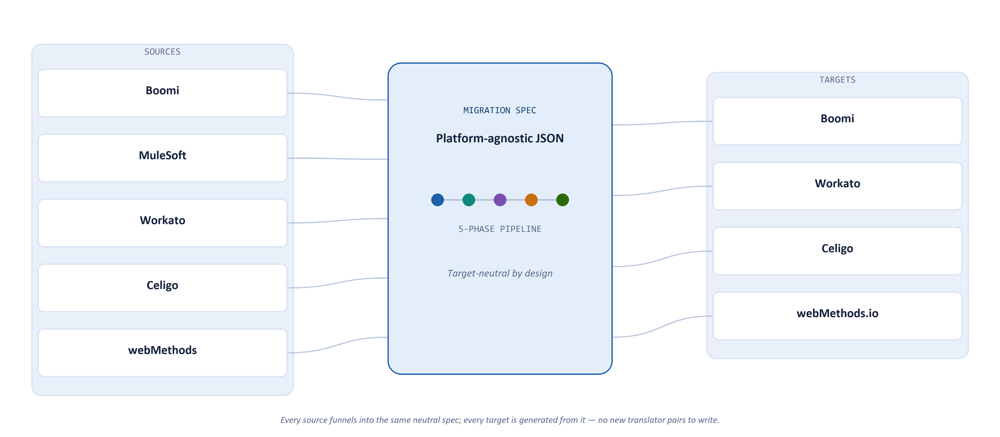

# MigrAIte — Product Documentation

**AI-powered integration migration agent.** MigrAIte moves integration flows between iPaaS platforms — Boomi, MuleSoft, Workato, Celigo, and webMethods.io/webMethods IS — without a human hand-translating every connector, transform, and error-handling branch.

*Reflects the codebase as of 2026-09-15. Built by TechStone LLC on top of the Boomi Companion (`bc-integration`) skill for Boomi-side operations.*

---

## Table of Contents

1. [Executive Overview](#1-executive-overview)
2. [Quickstart](#2-quickstart)
3. [Core Concepts](#3-core-concepts)
4. [The Five-Phase Pipeline](#4-the-five-phase-pipeline)
5. [Architecture & Repository Layout](#5-architecture--repository-layout)
6. [Using MigrAIte](#6-using-migraite)
7. [The Migration Spec — Schema Reference](#7-the-migration-spec--schema-reference)
8. [Operating Rules & Guardrails](#8-operating-rules--guardrails)
9. [Security & Credential Handling](#9-security--credential-handling)
10. [Troubleshooting & FAQ](#10-troubleshooting--faq)
11. [Required Environment / Credentials](#11-required-environment--credentials)
12. [Track Record](#12-track-record)
13. [Roadmap](#13-roadmap)

---

## 1. Executive Overview

### 1.1 The problem

Every iPaaS migration — an acquired company standardizing on one platform, a vendor contract ending, a cloud modernization initiative — is normally a manual re-implementation project: an integrator reads the old flow, mentally reverse-engineers its intent, and rebuilds it by hand in the new tool. That process is slow, inconsistent between integrators, and loses tribal knowledge that was never written down (error-handling conventions, retry logic, naming standards).

### 1.2 What MigrAIte does

MigrAIte automates the reverse-engineering and re-implementation steps around a **platform-agnostic intermediate representation** (the *migration spec*). A flow is first parsed out of its source platform into that neutral JSON representation — independent of any target — and only then translated into the target platform's native format. This is the same "compiler front-end / back-end" split used in real compilers, and it's what lets MigrAIte support *N* sources and *M* targets without writing N×M translators — it writes N analyzers and M generators instead.

### 1.3 How it works, at a glance



Every source funnels into the same neutral spec; every target is generated from it. Add a sixth source platform tomorrow and it works with all four existing targets for free — no new translator pairs to write.

### 1.4 Supported platforms

| Role | Platform | Status |
|---|---|---|
| **Source** (pull + analyze) | Boomi | ✅ Production |
| | MuleSoft | 🧪 Built — pre-production |
| | Workato | ✅ Production |
| | Celigo | 🧪 Built — pre-production |
| | webMethods.io / webMethods IS | ✅ Production |
| | Oracle SOA Suite / EBS | ⚠️ Analyzer built, not yet wired into the unified `migrate.py` CLI |
| **Target** (generate + push) | Boomi | ✅ Production |
| | Workato | ✅ Production |
| | Celigo | 🧪 Built — pre-production |
| | webMethods.io | 🧪 Built — pre-production |
| | MuleSoft | ❌ Not a supported target (no generator) |
| **Roadmap** | SAP, Azure Logic Apps | 📋 Planned — no analyzer/generator yet |

### 1.5 How a migration is delivered

MigrAIte isn't just a script — it's used through three different surfaces depending on the audience:

| Surface | Who uses it | What it's for |
|---|---|---|
| `migrate.py` CLI | Engineers, CI pipelines | Scriptable, reproducible, flag-driven migrations |
| **MigrAIte** Streamlit app (`app.py`) | Non-technical stakeholders, demos | Drag-and-drop a package zip or Google Drive link, watch the 5-phase pipeline run live, download the spec + Word design doc |
| Google Chat bot (`gchat/`) | Teams collaborating async in Chat | Kick off and monitor a migration from a Chat thread, backed by the Claude Agent SDK |

### 1.6 What comes out the other end

For every migration, MigrAIte produces:
- **The migrated artifacts themselves** — pushed live to the target platform (or written to disk with `--dry-run`).
- **A platform-agnostic migration spec** (`migration-specs/<project>.json`) — a durable, diffable record of what the source flow did, independent of either platform.
- **A branded Word design document** (`migration-specs/<project>_design_document.docx`) — for stakeholders who need to review *what* is being migrated without reading JSON or platform XML.
- **A gap/fidelity report** — anything that can't be mapped 1:1 (e.g., BPEL `<flow>` parallel branches, Human Tasks, NACHA file generation) is flagged explicitly rather than silently dropped or silently guessed at.

---

## 2. Quickstart

This walks through a migration end-to-end in dry-run mode — no credentials, no live pushes — using one of the bundled sample projects.

**1. Install dependencies**
```bash
pip install -r requirements.txt
```

**2. Copy the environment template** (only needed once you move past dry-run)
```bash
cp .env.example .env
```

**3. Run a dry-run migration against a bundled sample**
```bash
python migrate.py --from mulesoft --source-dir samples/mulesoft/customer-api/ --to workato --dry-run
```

**What you'll see:** the CLI prints one `[PHASE]`-tagged block per stage as it runs:
```
[PULL] Source files already on disk — skipping pull.
[ANALYZE] Parsing samples/mulesoft/customer-api/ ...
[ANALYZE] Wrote migration-specs/customer-api.json (3 flows, 1 gap)
[ENRICH] Generic enrichment pass ...
[DOCUMENT] Wrote migration-specs/customer-api_design_document.docx
[GENERATE] Dry run — Workato recipe JSON printed below, not pushed.
```

**4. Inspect the output**
```bash
cat migration-specs/customer-api.json          # the platform-agnostic spec
```
Open `migration-specs/customer-api_design_document.docx` for the stakeholder-facing summary.

**5. Go live**
Once `WORKATO_API_TOKEN` / `WORKATO_EMAIL` (or the Boomi credentials from Boomi Companion setup) are in `.env`, drop `--dry-run` to push for real:
```bash
python migrate.py --from mulesoft --source-dir samples/mulesoft/customer-api/ --to workato
```

Continue to [§6 Using MigrAIte](#6-using-migraite) for the full flag reference, or [§7](#7-the-migration-spec--schema-reference) to understand exactly what's in the spec file you just generated.

---

## 3. Core Concepts

A short glossary — these terms are used precisely throughout this document and the codebase.

| Term | Meaning |
|---|---|
| **Migration spec** | The platform-agnostic JSON file (`migration-specs/<project>.json`) that every analyzer produces and every generator consumes. Has no target-specific concepts in it. |
| **Analyzer** | A phase-2 script (`analyzers/analyze_<platform>.py`) that parses one *source* platform's native format into a migration spec. |
| **Enricher** | A phase-3 script (`enrichers/enrich_*.py`) that runs an LLM pass over the spec to resolve logic a static parser can't — nested sub-flow calls, ambiguous step intent. |
| **Generator** | A phase-4/5 script (`generators/generate_<platform>.py`) that compiles a migration spec into one *target* platform's native format and (unless `--dry-run`) pushes it live. |
| **Phase** | One of the five pipeline stages — Pull, Analyze, Enrich, Document, Generate. Every run executes all five unless an operator explicitly skips one. |
| **Integration / flow** | One migratable unit inside a spec's `integrations[]` array — a Boomi process, a Workato recipe, a MuleSoft flow, a BPEL composite. |
| **Gap** | An entry in a spec's `gaps[]` array: something the analyzer or enricher could not map with full confidence, recorded with a severity and a suggested resolution rather than silently guessed at. |
| **Fidelity score** | An informal measure (seen in project history as e.g. "80% — Grade C") of how much of a source flow's behavior survived the round trip into the target platform, based on how many gaps were found and how severe they are. |
| **Project name** | The `--project` value used to name the spec file and downstream outputs; defaults to the source folder/directory name. |
| **Dest name** | The `--dest-name` value used to name the target-side folder/project; defaults to `MIG_<project>`. |
| **Session continuity** | The convention that a migration project's spec (`migration-specs/<project>.json`) and progress notes (`migration-specs/<project>_progress.md`) persist across work sessions, so a session is never re-analyzed from scratch if a spec already exists. |

---

## 4. The Five-Phase Pipeline

Every migration — run through `migrate.py`, the Streamlit app, or the Chat bot — goes through the same five phases shown inside the spec node in §1.3. **No phase is ever skipped implicitly**; skipping is only ever an explicit flag (`--skip-pull`, `--skip-analyze`, etc.) chosen by the operator, e.g. to resume a session or re-run just the generate step against an edited spec.

| # | Phase | What happens | Skip flag |
|---|---|---|---|
| 1 | **PULL** | If the source is a *live* platform (Boomi, live Workato/Celigo accounts), fetch the components to local disk. MuleSoft/webMethods projects are usually already on disk (a zip export), so this is a no-op. | `--skip-pull` |
| 2 | **ANALYZE** | Run the analyzer matching `--from`. Parses the platform's native format (Boomi process XML, MuleSoft `.xml` flows, webMethods `.ndf`/`flow.xml`, etc.) into `migration-specs/<project>.json` — the canonical spec. | `--skip-analyze` |
| 3 | **ENRICH** | An LLM (Claude, via `ANTHROPIC_API_KEY`) pass over the spec that expands logic a static parser can't fully resolve — e.g. webMethods sub-flow/service calls that are only resolvable by reading the invoked service's own flow, or inferring intent behind ambiguously-named steps. webMethods gets a dedicated deep enrichment (`enrich_webmethods.py`); other sources get a lighter generic pass (`enrich_spec.py`). | `--skip-enrich` |
| 4 | **DOCUMENT** | Generates a TechStone-branded Word design document (`generate_word_doc.py`) summarizing the migration for a non-technical reviewer — the artifact a client or PM actually reads. | `--skip-document` |
| 5 | **GENERATE** | Run the generator matching `--to`. Translates the canonical spec into the target platform's native format and, unless `--dry-run` is passed, pushes it live to the target platform. | *(not skippable — it's the point of the run)* |

### 4.1 Why the spec is the center of gravity, not either platform

The canonical spec has **no target-specific concepts in it** — it describes triggers, steps, branching, loops, error handling, and data shape in platform-neutral terms. This is the single most important architectural decision in the codebase:

> **Why this matters:** because the spec is neutral, it's reusable. A webMethods package analyzed once has been generated into Workato *six separate times* across different sessions in this project's history (different recipe structures, different workspaces, different iteration) — none of which required re-running the analyzer against webMethods again. The expensive, fragile part (parsing a foreign platform's undocumented XML/flow format) happens once; regenerating into a different shape, or a different target platform entirely, is cheap.

---

## 5. Architecture & Repository Layout

```
iPaaS-Migration/
├── migrate.py                 # Single-command CLI entry point — orchestrates all 5 phases
├── app.py                     # "MigrAIte" Streamlit UI (branded, drag-and-drop)
├── analyzers/                 # Phase 2 — one file per SOURCE platform
│   ├── analyze_boomi.py
│   ├── analyze_mulesoft.py
│   ├── analyze_workato.py
│   ├── analyze_celigo.py
│   ├── analyze_webmethods.py
│   └── analyze_oracle_soa.py  # standalone — not yet wired into migrate.py
├── enrichers/                 # Phase 3 — AI enrichment
│   ├── enrich_spec.py         # generic pass
│   └── enrich_webmethods.py   # deep webMethods-specific pass
├── generators/                # Phases 4 & 5 — one file per TARGET platform (+ the Word doc)
│   ├── generate_boomi.py
│   ├── generate_workato.py
│   ├── generate_workato_from_wm.py   # webMethods -> Workato specialized path
│   ├── generate_celigo.py
│   ├── generate_webmethods.py
│   ├── generate_word_doc.py          # Phase 4 design document
│   └── push_workato_recipe_json.py
├── migration-specs/           # Output: canonical specs + Word docs + progress notes (per project)
├── active-development/        # Working directory for pulled/staged source artifacts (gitignored)
├── samples/                   # Realistic sample source projects for testing (see Quickstart)
├── references/                # Reference docs (mapping tables, schema)
├── Workato/Companion/         # workato-integration skill: recipe-building rules + RecipeComponents library
├── WebMethods/                # webMethods-specific analysis output, instructions, mapping Excel files
├── gchat/                     # Google Chat bot surface (Claude Agent SDK + Pub/Sub)
├── logos/                     # TechStone branding assets for generated documents/UI
└── requirements.txt
```

### 5.1 Built on Boomi Companion

This workspace is a **Boomi-oriented workspace first**: all Boomi-side platform operations (search, pull, push, create, folder management) go through the `boomi-integration` skill's shell scripts (`<skill-path>/scripts/*.sh`), never hand-rolled `curl`. This is a hard rule in the project's operating instructions — see [§8](#8-operating-rules--guardrails).

### 5.2 Tech stack

| Concern | Technology |
|---|---|
| Core pipeline | Python 3, `requests`, `python-dotenv` |
| AI enrichment | Anthropic API (`anthropic` SDK) |
| Streamlit UI | `streamlit` |
| Design docs | `openpyxl` (Excel mapping sheets), Word doc generation via `python-docx` |
| Boomi platform ops | Bash scripts from the `boomi-integration` skill |
| Google Chat bot | `claude-agent-sdk`, `google-cloud-pubsub`, `google-api-python-client` |

---

## 6. Using MigrAIte

### 6.1 Single-command CLI (`migrate.py`)

```bash
python migrate.py --from <source> --to <target> [options]
```

| Flag | Type | Default | Purpose |
|---|---|---|---|
| `--from` | `{boomi,mulesoft,workato,celigo,webmethods}` | *(required)* | Source platform |
| `--to` | `{boomi,mulesoft,workato,celigo,webmethods}` | *(required)* | Target platform — note MuleSoft is source-only |
| `--boomi-folder` | string | — | Pull live from this Boomi folder (mutually exclusive with `--source-dir`) |
| `--source-dir` | path | — | Use local files already on disk instead of pulling |
| `--project` | string | folder/dir name | Name used for the spec file and output naming |
| `--dest-name` | string | `MIG_<project>` | Name for the target-side folder/project |
| `--dry-run` | flag | `false` | Generate target artifacts without pushing them live |
| `--skip-pull` | flag | `false` | Skip the pull phase (use already-downloaded `active-development/` files) |
| `--skip-analyze` | flag | `false` | Skip the analyze phase (use an existing spec in `migration-specs/`) |
| `--skip-enrich` | flag | `false` | Skip the AI enrichment phase |
| `--skip-document` | flag | `false` | Skip the Word document generation phase |
| `--md-dir` | path | — | Attach a directory of `.md` analysis files as an appendix in the design document |

**Examples:**
```bash
# Boomi folder -> Workato, full pipeline, live push
python migrate.py --from boomi --boomi-folder "MIG_CustomerAPI" --to workato

# webMethods package -> Workato, with AI enrichment + Word doc
python migrate.py --from webmethods --source-dir active-development/wm_upload/extracted --to workato --project mypackage

# MuleSoft sample project -> Workato
python migrate.py --from mulesoft --source-dir samples/mulesoft/customer-api/ --to workato

# Dry run — inspect generated JSON without touching the target platform
python migrate.py --from boomi --boomi-folder "My Folder" --to workato --dry-run

# Resume from an existing spec (skip pull + analyze)
python migrate.py --from boomi --to workato --project my-proj --skip-pull --skip-analyze

# CI-friendly — skip the Word doc
python migrate.py --from mulesoft --source-dir exports/ --to workato --skip-document
```

### 6.2 Running phases individually

Useful when iterating on one phase without re-running the whole pipeline (e.g., tweaking generator output against an already-correct spec).

```bash
# Analyze only
python analyzers/analyze_boomi.py active-development/ --project my-project
python analyzers/analyze_mulesoft.py samples/mulesoft/customer-api/
python analyzers/analyze_webmethods.py <source-dir> --project <name>

# Oracle SOA Suite (live pull via REST, or from exported SAR files)
python analyzers/analyze_oracle_soa.py --project my-oracle-project
python analyzers/analyze_oracle_soa.py --source-dir /path/to/sars/ --project my-oracle-project
python analyzers/analyze_oracle_soa.py --composite-filter "Order*" --project orders

# Enrich only
python enrichers/enrich_spec.py migration-specs/<proj>.json
python enrichers/enrich_webmethods.py migration-specs/<proj>.json --source-dir <dir>

# Generate only
python generators/generate_workato.py migration-specs/my-project.json --folder "My Folder"
python generators/generate_workato.py migration-specs/my-project.json --dry-run
python generators/generate_word_doc.py migration-specs/<proj>.json --target <platform>
```

### 6.3 MigrAIte Streamlit app

```bash
python -m streamlit run app.py --server.port 8501
```

A branded, non-technical front end for the same pipeline: upload a source package as a zip (or paste a Google Drive share link), pick source/target platforms, toggle `dry-run` / `skip-analyze` / `skip-enrich` / `skip-document`, and watch the five phases run live with progress indicators keyed off the `[PHASE]` markers `migrate.py` prints to stdout. Results are shown in tabs — the migration spec JSON and the Word design document, both downloadable.

### 6.4 Google Chat bot

`python -m gchat.bot` runs a Pub/Sub pull loop: Google Chat events are pulled (not pushed — this machine is never called by Google), and replies go out as HTTPS calls to the Chat API. Each Chat thread maps to one agent session running on the Claude Agent SDK, so a migration can be kicked off and monitored conversationally from inside Chat rather than a terminal. Current constraint: one active migration globally at a time (a demo-stage limitation, not an architectural ceiling).

---

## 7. The Migration Spec — Schema Reference

Every analyzer emits, and every generator consumes, a spec with the same top-level shape (`schema_version: "1.0"`). This section documents the real fields, not an aspirational sketch — pulled directly from a spec produced by `analyze_workato.py`.

### 7.1 Top-level fields

| Field | Type | Description |
|---|---|---|
| `schema_version` | string | Spec format version (currently `"1.0"`) |
| `source_system` | string | Platform the spec was analyzed from, e.g. `"workato"`, `"boomi"`, `"mulesoft"` |
| `source_version` | string | Sub-variant of the source, e.g. `"workato_cloud"` |
| `project_name` | string | Matches the `--project` value used at analyze time |
| `analyzed_at` | string (ISO datetime) | When the analyze phase ran |
| `source_files_analyzed` | array | The source file(s)/folder(s) the analyzer read |
| `summary` | object | Roll-up counts — see §7.2 |
| `connections` | array | Reusable connections referenced by the flows (e.g. Salesforce, NetSuite credentials) |
| `integrations` | array | One entry per migratable flow — see §7.3 |
| `gaps` | array | Everything the analyzer/enricher couldn't map with full confidence — see §7.4 |
| `migration_notes` | array | Free-text notes for the operator carried through from analysis |

### 7.2 `summary`

| Field | Type | Description |
|---|---|---|
| `total_flows` | integer | Count of entries in `integrations[]` |
| `primary_flows` | integer | Top-level flows (excludes sub-flows) |
| `sub_flows` | integer | Nested/callable sub-flows |
| `total_connections` | integer | Distinct connections referenced |
| `gaps_found` | integer | Count of entries in `gaps[]` |
| `overall_complexity` | string | Heuristic rating, e.g. `"low"` / `"medium"` / `"high"` |

### 7.3 `integrations[]`

| Field | Type | Description |
|---|---|---|
| `name` | string | Flow name in the target/spec namespace |
| `source_name` | string | Original name in the source platform |
| `recipe_id` / equivalent | string | Source platform's native identifier for the flow |
| `description` | string | Human-readable summary |
| `flow_type` | string | e.g. `"scheduled"`, `"triggered"`, `"callable"` |
| `trigger` | object | The flow's entry point — type, provider, schedule/listener config, `requires_review` flag |
| `steps` | array | Ordered step list — each carries `type`, `sequence`, `label`, `complexity`, `requires_review`, and (when applicable) `behavioral_difference` / `suggested_resolution` / `severity` |
| `connections_used` | array | Which `connections[]` entries this flow depends on |
| `error_handling` | object | `has_error_handler` (bool) + `strategies[]` |

### 7.4 `gaps[]`

| Field | Type | Description |
|---|---|---|
| `flow` | string | Which integration this gap belongs to |
| `step_type` | string | The step type involved, e.g. `"connector_action"` |
| `sequence` | integer | Step position within the flow |
| `source_ref` | string | Traceable pointer back into the source (e.g. `"AIMigrationTest5:step-1"`) |
| `label` | string | Step label, if the source platform provided one |
| `note` | string | Short summary, e.g. `"Manual review required"` |
| `behavioral_difference` | string | What's not guaranteed to carry over 1:1 |
| `suggested_resolution` | string | A concrete next action — often a specific skill script to run |
| `severity` | string | `"low"` / `"medium"` / `"high"` |
| `decision_required` | boolean | Whether a human must choose between options before this can be resolved |
| `auto_resolved` | boolean | Whether the enrichment pass was able to close this gap on its own |

### 7.5 Real example (trimmed)

```json
{
  "schema_version": "1.0",
  "source_system": "workato",
  "source_version": "workato_cloud",
  "project_name": "aimigrationtest5",
  "summary": {
    "total_flows": 1,
    "primary_flows": 1,
    "sub_flows": 0,
    "total_connections": 0,
    "gaps_found": 2,
    "overall_complexity": "medium"
  },
  "integrations": [
    {
      "name": "AIMigrationTest5",
      "flow_type": "scheduled",
      "trigger": {
        "type": "scheduler",
        "workato_provider": "clock",
        "workato_name": "scheduled_event",
        "schedule": { "time_unit": "days", "trigger_every": "1", "trigger_at": "00:00:00" }
      },
      "steps": [
        {
          "type": "connector_action",
          "sequence": 1,
          "requires_review": true,
          "severity": "medium",
          "behavioral_difference": "Workato connector action — verify Boomi has equivalent native connector before using REST.",
          "suggested_resolution": "Run boomi-component-search.sh to find native connector; if none found, use REST with custom auth."
        }
      ],
      "error_handling": { "has_error_handler": false, "strategies": [] }
    }
  ],
  "gaps": [
    {
      "flow": "AIMigrationTest5",
      "step_type": "connector_action",
      "sequence": 1,
      "note": "Manual review required",
      "severity": "medium",
      "decision_required": false,
      "auto_resolved": false
    }
  ]
}
```

This is the actual spec behind the "AIMigrationTest5" migration referenced in §12 — a real connector step the Workato API didn't expose enough metadata about, flagged rather than guessed at, with an explicit next action for the operator.

### 7.6 Naming convention for generated components

```
MIG_<SourceSystem>_<FlowName>_<ComponentType>

Examples:
  MIG_MS_GetCustomers_Process
  MIG_MS_PostgreSQL_Connection
  MIG_MS_CustomerResponse_JSON_Profile
```

Boomi-side folder structure: `ClaudeCode/MIG_<ProjectName>/`.

### 7.7 Session continuity

Migration projects routinely span multiple work sessions. The convention:
1. Check `migration-specs/` for an existing spec before starting — **don't re-analyze** if one already exists and source files haven't changed.
2. Resume from wherever the last session left off.
3. After each generation session, record done/pending/blocked flows in `migration-specs/<project>_progress.md`.

---

## 8. Operating Rules & Guardrails

These are hard constraints this codebase (and any agent operating it) follows — not suggestions:

1. **Never hand-roll `curl` against the Boomi API.** All Boomi platform operations go through the `boomi-integration` skill's `.sh` scripts. Needing custom `curl` is treated as a stop-and-discuss moment.
2. **Auth errors halt, they don't retry.** A Boomi auth failure stops the session for a human to look at — repeated calls with bad credentials risk an account lockout.
3. **Connector discovery before generation.** Before designing a Boomi-target integration, the account's live native connectors are checked (`boomi-component-search.sh --type connector-settings,connector-action`) — a generic REST call is a fallback, not a default, when a native NetSuite/Salesforce/etc. connector already exists in the account.
4. **Credentials stay out of the conversation where possible.** Production credentials are preferentially pulled pre-encrypted from the Boomi platform GUI rather than typed into component XML by hand; user-supplied credentials are honored if explicitly given, with a reminder of the safer path.
5. **`.env` is never read directly** — it's loaded internally by the shell scripts via `source .env`, keeping secrets out of the agent's context window.
6. **Component IDs are account-scoped.** IDs recorded from a personal/dev Boomi account do not exist on an org account — migration specs are portable and reusable across accounts, but pushed component IDs are not; a fresh account means first-time pushes use `boomi-component-create.sh`, not `boomi-component-push.sh`.

---

## 9. Security & Credential Handling

MigrAIte handles two categories of secret: platform API credentials (Boomi, Workato, Anthropic) and the source/target systems' own connection credentials (databases, Salesforce, NetSuite, etc.) that get referenced inside generated components.

**Platform API credentials** live in `.env` and are never read by the agent directly — every CLI script loads them internally via `source .env` inside its own subprocess, so a value never has to pass through the conversation to be used.

**Connection credentials referenced inside migrated components** follow a strict preference order:
1. **Pull from platform** (preferred): production credentials are configured once in the Boomi/Workato GUI, then the *pre-encrypted* value is pulled down as part of a component pull — the plaintext secret never enters the conversation at all.
2. **User-provided** (acceptable): if a user shares a credential directly in conversation, it can be used in component XML/JSON — with a reminder of option 1 if it looks like a production secret.
3. **Never recited back**: credentials are avoided in plans, summaries, or overviews, since those can be visible during screen sharing or persist in a context window longer than necessary.

**Account portability:** a migration spec is reusable across Boomi accounts (dev/personal → org/team), but the *component IDs* pushed during a run are not — they're specific to the account they were created in. Moving to a new account means the first push uses `boomi-component-create.sh` (which mints new IDs), not `boomi-component-push.sh` (which targets an existing component).

---

## 10. Troubleshooting & FAQ

**"I got a Boomi auth error mid-run — why did it just stop?"**
By design. Repeated calls against the Boomi API with bad credentials risk an account lockout, so an auth failure halts the session for a human to check credentials rather than retrying automatically. Run `bash <skill-path>/scripts/boomi-env-check.sh` to see which `.env` variables are set, then `bash <skill-path>/scripts/boomi-folder-create.sh --test-connection` to confirm connectivity.

**"`curl` failed with exit code 35 (SSL handshake failure)."**
This is almost always corporate SSL-inspection middleware (Zscaler, Netskope, Cisco Umbrella) or a VPN intercepting the TLS handshake, not a MigrAIte bug. Check that tooling before troubleshooting further.

**"I got 'ComponentId invalid' when pushing to Boomi."**
There's no sync state for that component yet — usually because it's the first push on a new account, or the local `.sync-state/` was cleared. Use `boomi-component-create.sh`, not `boomi-component-push.sh`, for a first-time push.

**"I'm resuming a migration on a different Boomi account than where it started."**
Component IDs and folder IDs recorded from a previous account do not exist on a new one. Re-run credential setup and connector discovery, but **do not re-analyze** — the migration spec in `migration-specs/*.json` is account-agnostic and can go straight to the generate phase.

**"A parallel branch in my source flow ran sequentially after migrating to Boomi."**
Known, flagged gap: BPEL `<flow>` (true parallel execution) maps to a Boomi Branch shape, which executes its paths sequentially. This is recorded in the spec's `gaps[]` with `severity` set accordingly, not silently dropped.

**"Why does the generator want a native connector instead of REST?"**
Per the connector discovery guardrail (§8.3), the target Boomi account is checked for native connectors (NetSuite, Salesforce, etc.) before defaulting to generic REST — a native connector is almost always more appropriate than hand-rolled REST + custom auth.

---

## 11. Required Environment / Credentials

Set in `.env` (never read directly by the agent — loaded internally by the CLI scripts). See `.env.example` for the full annotated list.

| Platform | Key variables |
|---|---|
| Boomi | Configured during Boomi Companion setup |
| Workato | `WORKATO_API_TOKEN`, `WORKATO_EMAIL` |
| Anthropic (LLM enrichment) | `ANTHROPIC_API_KEY` |

Credential health checks: `bash <skill-path>/scripts/boomi-env-check.sh` and `bash <skill-path>/scripts/boomi-folder-create.sh --test-connection`.

---

## 12. Track Record

MigrAIte has moved real flows across every supported direction, including production webMethods IS packages for a banking client (payment routing, compliance checks against Oracle) into both Workato and Boomi, a Workato-authored Salesforce↔NetSuite sync into Boomi, and a full Oracle SOA Suite/BPEL sample suite into Boomi at an 80% automated-fidelity score. Every run leaves behind its spec, its design document, and an explicit list of what still needs a human — nothing is migrated by silent guesswork.

---

## 13. Roadmap

*(to be defined)*
