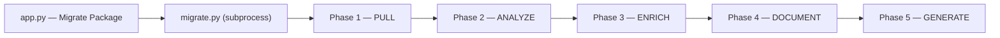
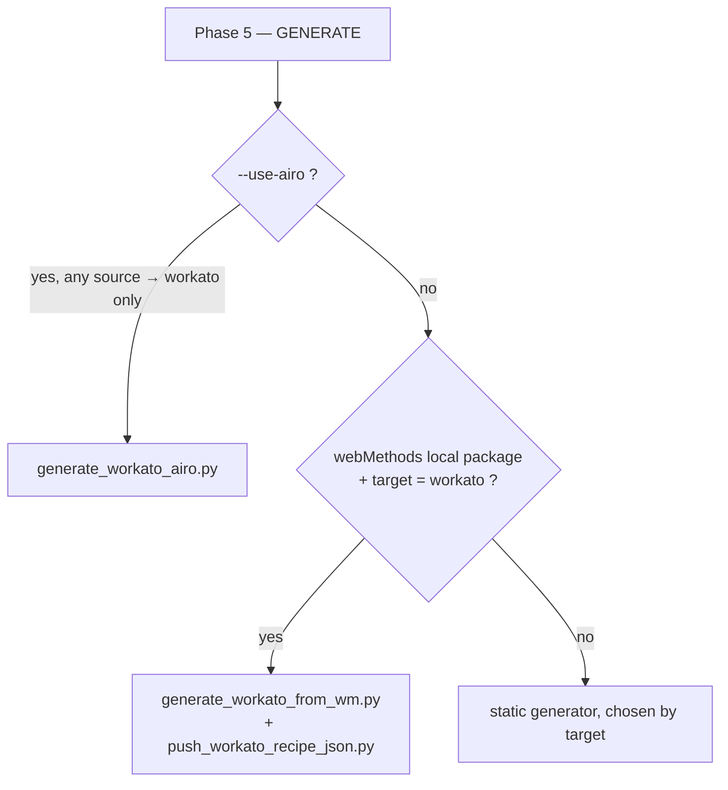

# MigrAIte GUI Architecture

A ground-truth map of every file, script, and prompt the MigrAIte Streamlit GUI
(`app.py`) can reach — built by reading the actual code, not the project's own
docs (which have drifted from reality more than once). Use this as the
reference baseline before designing how the pipeline gets carved into skills.

> **Three modes, one real pipeline.** `app.py` has a mode switch with three
> options. Only one of them — **Migrate Package** — touches `migrate.py` or
> anything under `analyzers/`, `generators/`, or `enrichers/`. The other two
> are self-contained in `app.py` with their own inline prompts and pushes.

| Mode | Handling | Subprocess? |
|---|---|---|
| **Migrate Package** | Default branch (falls through past the two early-returns below). Builds a CLI command and shells out to `migrate.py`. | Yes — `migrate.py` |
| **Generate from Analysis** | Early return, `app.py:1897–2015`. Reads an uploaded `.md`, calls Claude directly via the classic `anthropic` SDK, pushes via an in-process HTTP POST. | No |
| **Push Recipe JSON** | Early return, `app.py:2018–2122`. Parses an uploaded recipe JSON, pushes via the same POST helper. No LLM at all. | No |

---

## Setup — before you run a migration from the GUI

What you need depends on which source and target you pick. Nothing below is
specific to one platform pair — this is the full matrix, grounded in what
each credential form field and script actually reads.

### 1 · Credentials for your source — only matters for a LIVE pull

A source pointed at a local directory/upload needs none of this. Live pull
only applies to the platforms below (MuleSoft has no live pull at all —
file-only, always).

| Source | Live-pull trigger | Env vars | Verify |
|---|---|---|---|
| Boomi | `--boomi-folder` | Managed by the boomi-integration skill's own `.env` (Boomi Companion setup) — **not** the GUI's own Boomi credential fields, see flag below | `bash <skill-path>/scripts/boomi-env-check.sh`, then `bash <skill-path>/scripts/boomi-folder-create.sh --test-connection` |
| MuleSoft | | | |
| Workato | `--folder` | `WORKATO_API_TOKEN`, `WORKATO_EMAIL` | — |
| Celigo | | | |
| webMethods | `--wmio-project` | `WMIO_TENANT_URL`, `WMIO_USERNAME`, `WMIO_PASSWORD` | — |

> **⚠ The GUI's own Boomi credential fields are mostly unused.** Both the
> source and target forms render `BOOMI_API_URL` / `BOOMI_ACCOUNT_ID` /
> `BOOMI_USERNAME` / `BOOMI_API_TOKEN` / `BOOMI_ENVIRONMENT_ID` input boxes
> (`app.py` — `source_credential_form()` / `target_credential_form()`), but
> neither `migrate.py` nor `generate_boomi.py` reads any of those variable
> names — only `BOOMI_TARGET_FOLDER` is referenced, as an optional fallback.
> The real Boomi pull/push mechanism shells into the boomi-integration
> skill's own scripts, which read their own `.env` configuration from Boomi
> Companion setup, entirely separate from this form. Filling in these GUI
> fields does not configure Boomi access — verifying via the skill's own
> scripts above does.

### 2 · Credentials for your target — Generate phase

| Target | Env vars / mechanism |
|---|---|
| Workato | `WORKATO_API_TOKEN`, `WORKATO_EMAIL` — used for folder resolution and any direct REST push. A `--use-airo` build authenticates its actual build session differently (see §3), but still uses this token to resolve/create the destination folder first. |
| Celigo | |
| webMethods.io | |
| Boomi | Same caveat as above — real push goes through the boomi-integration skill's `scripts/boomi-component-create.sh`, not the GUI's Boomi credential fields. |
| MuleSoft | |

### 3 · Claude Code's own login — whenever an LLM phase runs

This applies regardless of source/target, anytime the pipeline reaches a
phase that calls an LLM:

- **Enrich runs by default** on almost every migration (unless `--skip-enrich`) and rides on **Claude Code's own OAuth login** via `claude_agent_sdk` — not a separate Anthropic API key. You need to be logged into Claude Code on this machine for it to do anything beyond pass through unresolved steps.
- **Generate** only needs this when using `--use-airo` (target = Workato) or the webMethods-direct path (local webMethods → Workato, no AIRO). The static generators (`generate_workato.py`, `generate_boomi.py`, `generate_celigo.py`, `generate_webmethods.py`) call no LLM at all and need none of this.
- `pip install claude-agent-sdk` — required whenever either of the above applies; both `enrich_spec.py` and `generate_workato_airo.py` hard-exit with an explicit error if it's missing.
- **Do not set `ANTHROPIC_API_KEY`** in `.env` unless you specifically want Enrich/AIRO billed to a separate Anthropic Console account. If it's set, the spawned Claude Code subprocess inherits it from the environment and silently prefers it over your OAuth login — the scripts that call an LLM actively strip it before connecting for exactly this reason, but only if nothing re-exports it after.
- `ANTHROPIC_API_KEY` *is* required, separately, only for the GUI's "Generate from Analysis" mode (classic SDK) — unrelated to the main Migrate Package pipeline.

### 4 · Launch
- `streamlit run app.py` from the repo root.
- Right now, the Target picker is pinned to Workato only and Workato is hidden as a source option (`DEMO_WORKATO_ONLY_TARGET` / `DEMO_HIDE_WORKATO_SOURCE` in `app.py`) — this is a demo-specific restriction, not a general limitation; both are one-line flags to revert.

> **Nothing here protects your Workato budget automatically.** AIRO builds
> are capped per-recipe via `.env`: `AIRO_GEN_MAX_COST_USD` (default
> $10.00), `AIRO_GEN_MAX_TURNS` (default 200), `AIRO_GEN_TURN_TIMEOUT_S`
> (default 1800s). These are real ceilings the script enforces, not
> documentation — worth tuning before a bulk run across many flows. This
> only applies when `--use-airo` is in play; the other generators have no
> comparable cost at all.

---

## Click-to-recipe flowchart

The full sequence for Boomi → Workato with AIRO, start to finish. Blue
nodes are real code (deterministic, no LLM); the two amber nodes are the
only places an LLM is involved, each its own separate process.

```mermaid
flowchart TD
    classDef code fill:#e8ecff,stroke:#5b74ff,color:#1a1a2e;
    classDef llm fill:#fff3d6,stroke:#b8860b,color:#3a2e00;
    classDef io fill:#e6f4ee,stroke:#187248,color:#0d3320;

    A["You click Run Migration\n(app.py)"]:::code --> B["Validate form inputs\n(fast, no subprocess yet)"]:::code
    B --> C["Stash params in session_state,\nset _migration_running = True,\nst.rerun()"]:::code
    C --> D["_run_locked_migration()\nlaunches migrate.py as a real subprocess\n(page now click-locked, still visible)"]:::code

    D --> P1["Phase 1 — PULL\nBoomi skill scripts pull real\ncomponent XML to disk"]:::io
    P1 --> P2["Phase 2 — ANALYZE\nanalyze_boomi.py\nXML → canonical spec JSON"]:::code
    P2 --> P3["Phase 3 — ENRICH\nenrich_spec.py"]:::llm
    P3 --> P3a["LLM call per requires_review step\n(claude_agent_sdk, your OAuth login)\nfills field_mappings, groovy_equivalent, etc."]:::llm
    P3a --> P4["Phase 4 — DOCUMENT\ngenerate_word_doc.py\nspec → .docx (pure python-docx)"]:::code
    P4 --> P5["Phase 5 — GENERATE\ngenerate_workato_airo.py"]:::llm
    P5 --> P5a["REST call resolves/creates\nthe Workato folder (no LLM)"]:::code
    P5a --> P5b["Live ClaudeSDKClient session +\nworkato-airo-mcp-server tools"]:::llm
    P5b --> P5c["Agent calls real MCP tools —\nrecipe_builder_init / add_step /\nset_input_field / push —\neach one writes to Workato LIVE"]:::llm
    P5c --> P5d["Agent's final reply parsed for\nStatus: PLATFORM|DRAFT,\nwritten to *_workato_airo_output.json"]:::llm

    P5d --> E["migrate.py subprocess exits"]:::code
    E --> F["_run_locked_migration() writes\nst.session_state['_artifacts'],\nunlocks the page, reruns once more"]:::code
    F --> G["GUI shows AIRO Build Summary tab:\nagent's summary + recipe link +\nStatus PLATFORM or DRAFT"]:::code
    G --> H["You open the link in Workato —\nsame recipe object the agent\nedited live, created Stopped"]:::io
```

---

## Mode 1 — Migrate Package

### GUI ↔ migrate.py plumbing
- `build_migrate_cmd()` — `app.py:1281–1323` — assembles the `migrate.py` argv list from form state.
- `stream_subprocess()` — `app.py:1337–1353` — runs it via `subprocess.Popen`, streaming stdout into a queue.
- The click handler (`app.py:2297–2394`) does *not* run the subprocess inline. It stashes `{cmd, combined_env, source, target, …}` into `st.session_state["_pending_run"]`, sets `_migration_running = True`, and reruns.
- `_run_locked_migration()` — `app.py:1670–1840` — runs on the next execution, reads `_pending_run`, drives the live 5-step tracker from `[PHASE]` markers in stdout, and on completion writes `st.session_state["_artifacts"]` (spec path, recipe-file globs, AIRO output path, token, folder).
- After completion, `app.py:2399–2686` renders one tab per discovered artifact (AIRO Build Summary, one `Recipe: <svc>` tab per generated recipe JSON, Migration Spec, Design Document), each with its own "Push to Workato" button.

### Phase 1 — Pull `[code only]`
`migrate.py:679–713`
- Only **Boomi** has a live pull path, and only with `--boomi-folder`: `pull_boomi_folder()` (`migrate.py:185–281`) shells into the **boomi-integration skill's own CLI scripts** (outside this repo) — `boomi-component-search.sh` then `boomi-component-pull.sh` per matched component.
- `clear_boomi_component_dirs()` (`migrate.py:118–152`) wipes stale `active-development/` subfolders before every fresh pull; a 0-component pull hard-fails rather than silently continuing with stale data.
- `--boomi-process "<name(s)>"` narrows a folder pull to just the named process(es) plus their dependency closure (`migrate.py:208–246`), instead of pulling the whole folder.
- Workato / Celigo / webMethods.io "live pull" have **no separate Pull phase script** — the analyzer itself hits the live API during Phase 2.
- MuleSoft has no live pull anywhere in the codebase (file-only).

### Phase 2 — Analyze
`migrate.py:286–346`, dispatch dict `ANALYZERS` at `migrate.py:289–295`

| Source | Script | Arg style |
|---|---|---|
| boomi | `analyzers/analyze_boomi.py` | positional `<source_dir>` |
| mulesoft | `analyzers/analyze_mulesoft.py` | positional `<source_dir>` |
| workato | `analyzers/analyze_workato.py` | `--source-dir` or live `--folder <name>` |
| celigo | `analyzers/analyze_celigo.py` | `--source-dir` or live `--integration <name>` |
| webmethods | `analyzers/analyze_webmethods.py` | `--source-dir` or live `--wmio-project <name>` |

All run as `python <script> [source] --project <name> --output migration-specs/<name>.json` via plain `subprocess.run` — no LLM involved in any analyzer.

> **⚠ Orphaned script.** `analyzers/analyze_oracle_soa.py` (1,518 lines —
> live Oracle SOA REST pull, SAR-zip parsing, BPEL/composite.xml parsing,
> fully built) is **absent from `ANALYZERS`, absent from `migrate.py`'s
> `PLATFORMS` choices, and absent from `app.py`'s source list** —
> unreachable from both the GUI and the CLI entry point, despite CLAUDE.md
> documenting `python migrate.py --from oracle_soa --to boomi` as a working
> command.

### Phase 3 — Enrich `[LLM]`
`migrate.py:349–376`, `run_enrich()` — soft-fail (a bad exit code only warns; the pipeline continues)
- **webMethods, local IS package** (real `flow.xml` on disk, not a live pull) → `enrichers/enrich_webmethods.py`
- **Everything else** — including a *live* `--wmio-project` pull — → `enrichers/enrich_spec.py`

The branch is driven by `is_wmio_live_pull` (`migrate.py:358`), not a plain `source == "webmethods"` check — a three-way split, not two.

**`enrich_spec.py`** — Generic per-step enrichment for any `requires_review: true` step. Uses `claude_agent_sdk` (Claude Code's own OAuth, not `ANTHROPIC_API_KEY` — the key is explicitly stripped from the subprocess env before connecting). One query *per flagged step*, routed to one of five prompt templates by step type: `TRANSFORM_PROMPT`, `HTTP_STEP_PROMPT`, `CONDITION_PROMPT`, `SQL_PROMPT`, `GAP_STEP_PROMPT`.

**`enrich_webmethods.py`** — webMethods-only. Walks the real `ns/` flow.xml tree, resolves each entry point's full local service-invocation chain (capped depth 6 / 20 services), and sends the raw XML to Claude in **one big call** that returns a fully expanded `integrations` array — replacing the shallow static-analyzer output wholesale. Also exports `ClaudeAgentSession` and chain-resolution helpers that `generate_workato_from_wm.py` imports directly — this "enricher" doubles as a shared library, not just a pipeline phase.

### Phase 4 — Document `[code only]`
`migrate.py:380–399` — always `generators/generate_word_doc.py`, regardless of source/target. Pure `python-docx` assembly, no network or LLM calls. Soft-fail like Enrich.

### Phase 5 — Generate
`migrate.py:402–509`, dispatch at `migrate.py:760–812` — first match wins:

| Target | Static generator | Dest flag |
|---|---|---|
| workato | `generators/generate_workato.py` | `--folder` |
| celigo | `generators/generate_celigo.py` | `--integration` |
| webmethods | `generators/generate_webmethods.py` | `--project` |
| boomi | `generators/generate_boomi.py` | `--project` |
| mulesoft | *none — hard error if selected as target* | — |

`--skip-generate` (`migrate.py:610–615, 739–758`) stops the whole pipeline right after Document, before any generator — including AIRO — is invoked. This is the mechanism the GUI's AIRO approval-gate is built on (see below).

**`generate_workato_airo.py` `[LLM — live MCP agent]`** — The central AI-driven build path. Drives a live `claude_agent_sdk` agent session with the real **workato-airo-mcp-server** MCP tools wired in, so every connector/action is resolved and schema-validated against the live Workato platform instead of guessed. Budget-capped via `.env` (default $10 / 200 turns / 1800s).

`build_prompt()` (`generate_workato_airo.py:174–299`) structure:
1. **SPEC** — points at the migration-spec path, states the canonical shape, one recipe per `integrations` entry.
2. **FIRST STEPS** — mandates reading the recipe-builder docs before building; never guess a connector, always resolve live.
3. **Folder targeting** — two variants depending on whether the folder was already resolved via plain REST beforehand.
4. **Step comments** — one line max per step: shape mirrored + purpose, no component IDs or parameter dumps.
5. **Build, one recipe per flow** — naming rule, trigger/step mapping guidance, and an explicit "never silently drop a step" instruction.
6. **While working** — anti-loop guardrail (no more than two identical tool calls in a row).
7. **Final summary** — a fixed per-recipe Markdown template (name, one-line description, link, `Status: PLATFORM|DRAFT` taken verbatim from the last push response, up to 3 "finish setup" bullets). This exact text is what the GUI's AIRO Build Summary tab renders, and what `main()` regexes for to compute `has_draft`.

> A known platform constraint baked into the prompt/docstring: the Oracle
> connector's entire action schema is connection-gated server-side (can't
> even name a stored procedure without a live connection), while REST/HTTP
> is not.

**`generate_workato_from_wm.py` `[LLM]`** — webMethods-direct-to-Workato. Bypasses the platform-agnostic spec for recipe construction, calling Claude once *per entry-point service* (8s pacing, 3× retry/backoff on rate limits). Reuses `ClaudeAgentSession` from `enrich_webmethods.py`.

### AIRO approval gate (GUI-side)

> **⚠ Dry-run is not uniform.** Static generators and
> `generate_workato_from_wm.py` are genuinely dry under `--dry-run`.
> `generate_workato_airo.py` is **never** dry — `recipe_builder_init` saves
> an empty recipe to the live platform the instant it's called, so
> `--dry-run` is accepted for CLI compatibility but changes nothing except a
> printed banner line.

Because of that, when "Dry run" + "Build via AIRO" are both checked, the GUI passes `--skip-generate` to stop `migrate.py` one phase early (spec + doc only, no platform contact), then shows a separate **"Generate & Push via AIRO"** button (`app.py:2418–2519`) that runs `generate_workato_airo.py` directly as a second subprocess once clicked.

---

## Mode 2 — Generate from Analysis

Entirely inline in `app.py:1897–2015`. Uploads an Analysis.md, calls Claude via the **classic `anthropic` SDK** (one of only two call sites left on it — the other is the out-of-scope `scripts/wm_migration_agent.py`), then pushes via `push_recipe_workato()`.

`GENERATION_PROMPT` (`app.py:1378–1471`) structure:
- Task: read the uploaded Analysis.md, generate recipe JSON for the *primary flow only* (explicitly skips batch/NACHA-style flows).
- Required output: exactly 4 top-level keys — `name`, `description`, `code`, `config`.
- Worked JSON templates for: callable-recipe trigger, `each` loop (never `foreach`), if/else (conditions nested under `input`, never top-level), HTTP POST action (the only valid external-call provider), rescue-as-sibling error handling.
- Data-pill convention: literal `"[PILL: alias.field]"` placeholders for manual post-push wiring.
- 9 numbered "hard rules" reinforcing the same constraints, plus schema-field-type restrictions (object/array silently wipes a trigger's entire schema) and "every `if` needs a terminal `else`."

> **⚠ Duplicate prompt logic.** This prompt is nearly identical, maintained
> completely separately, to `generate_workato_from_wm.py`'s own `PROMPT`
> constant — same recipe-format rules, same hard-rule list. A fix to one has
> no mechanism to propagate to the other.

---

## Mode 3 — Push Recipe JSON

Entirely inline in `app.py:2018–2122`. Uploads a recipe JSON, previews its name and step count, pushes via the same `push_recipe_workato()`. No LLM involved at all.

---

## Shared & supporting files

- `_validate_recipe_code()` (`app.py:1547–1602`) — static lint for known-broken Workato patterns, run before every push in every mode.
- `migration-specs/<project>.json` — the platform-agnostic spec; produced by Analyze/Enrich, consumed by Document/Generate, read directly by the "Migration Spec" tab.
- `migration-specs/<project>_design_document.docx` — Document phase output.
- `migration-specs/<project>_<service>_workato_recipe.json` — one per flow, glob-matched for per-recipe tabs.
- `migration-specs/<project>_workato_airo_output.json` — AIRO run output (`summary`, `cost_usd`, `recipe_statuses`, `has_draft`).
- `logos/` — topbar branding + `logos/connectors/{boomi,celigo,mulesoft,webmethods,workato}.png` for platform tiles. No Oracle SOA or SAP logo exists, consistent with those not being user-selectable today.
- `.env` loading — `app.py`, `enrich_spec.py`, `enrich_webmethods.py`, `generate_workato_airo.py`, and `push_workato_recipe_json.py` each carry their own near-identical private copy of a `.env` loader rather than a shared util.

---

## Known drift & inconsistencies

These are the things most likely to bite a skill-design pass if assumed away — each one is a real finding from the code, not a guess.

> **1 · CLAUDE.md phase-count drift.** The personal `~/CLAUDE.md` describes
> a 3-phase pipeline (Pull → Analyze → Generate). The repo-root `CLAUDE.md`
> describes 5 phases. **The actual code implements 5 phases**
> (Pull/Analyze/Enrich/Document/Generate) — the personal copy is the stale
> one.

> **2 · Oracle SOA is fully orphaned.** `analyzers/analyze_oracle_soa.py` is
> a real, substantial, independently-runnable 1,518-line script with no
> wired path through either `migrate.py` or the GUI, despite CLAUDE.md
> documenting it as a working `--from oracle_soa` command. A skill reorg
> needs to either treat it as a standalone tool chained by hand to
> `enrich_spec.py`/`generate_boomi.py`, or flag it as a real integration
> gap.

> **3 · Demo flag hides 3 of 4 real targets.** `DEMO_WORKATO_ONLY_TARGET =
> True` (`app.py:44`) currently limits the GUI's Target picker to Workato
> only. `TARGET_PLATFORMS` itself still lists all 4, and every downstream
> generator/credential-form/migrate.py path is fully wired for
> Boomi/Celigo/webMethods — they're dead code from the *running app's*
> perspective only, not structurally missing. One-line revert.

> **4 · generate_boomi.py shells into the boomi-integration skill
> directly.** `generate_boomi.py:1235–1278` calls the boomi-integration
> skill's own `scripts/boomi-component-create.sh` via `bash` for its
> live-push path — a genuine cross-dependency into that skill's material,
> currently reachable only via direct CLI use (hidden from the GUI by flag
> #3).

> **5 · Two separate "push a recipe JSON" implementations.** `app.py`'s
> `push_recipe_workato()` (used by both standalone modes and the
> Migrate-Package artifact tabs) and `generators/push_workato_recipe_json.py`
> (used only by the webMethods-direct branch) independently re-implement the
> same validation/normalization logic.

> **6 · Duplicate recipe-format prompt text.** `app.py`'s `GENERATION_PROMPT`
> and `generate_workato_from_wm.py`'s `PROMPT` encode nearly the same
> Workato JSON-format rules in two separately-maintained strings. See Mode 2
> above.

> **7 · Dry-run semantics differ per generator.** Static generators are
> genuinely dry; `generate_workato_airo.py` never is. The GUI compensates
> with a `--skip-generate`-based approval gate rather than relying on
> `--dry-run` passthrough. See the AIRO section above.

> **8 · GUI vs. CLI default divergence.** The GUI's "Skip document"
> checkbox defaults to **checked** (`app.py:2254`), so a GUI-driven run
> skips the Word doc by default — while running `migrate.py` directly from
> the CLI without `--skip-document` generates it by default. Same pipeline,
> different default depending on entry point.

> **9 · Enrichment routing is a three-way split, not two.** Local webMethods
> IS packages (real `flow.xml`) go to `enrich_webmethods.py`; a *live*
> webMethods.io pull and every other source go to `enrich_spec.py`. Driven
> by `is_wmio_live_pull`, not a plain source-name check.

> **10 · The GUI's Boomi credential fields are mostly unused.** Both
> `source_credential_form()` and `target_credential_form()` (`app.py`)
> render full Boomi credential inputs (`BOOMI_API_URL`, `BOOMI_ACCOUNT_ID`,
> `BOOMI_USERNAME`, `BOOMI_API_TOKEN`, `BOOMI_ENVIRONMENT_ID`), but neither
> `migrate.py` nor `generate_boomi.py` reads any of them — only
> `BOOMI_TARGET_FOLDER` is referenced, as an optional fallback. Real Boomi
> access goes entirely through the boomi-integration skill's own `.env`
> setup via Boomi Companion. Filling in this part of the GUI form has no
> effect on whether Boomi access actually works.

---

## File index (appendix)

| File | What it does | Kind |
|---|---|---|
| `app.py` | Streamlit GUI — all 3 modes, subprocess orchestration, push logic | LLM (1 mode) |
| `migrate.py` | 5-phase CLI pipeline orchestrator | code |
| `analyzers/analyze_boomi.py` | Boomi component XML → spec | code |
| `analyzers/analyze_mulesoft.py` | MuleSoft 4.x flow XML → spec | code |
| `analyzers/analyze_workato.py` | Live Workato REST pull / exported JSON → spec | code |
| `analyzers/analyze_celigo.py` | Live integrator.io pull / exported JSON → spec | code |
| `analyzers/analyze_webmethods.py` | webMethods IS flow XML / webMethods.io cloud → spec | code |
| `analyzers/analyze_oracle_soa.py` | Oracle SOA BPEL/SAR → spec | **orphaned** |
| `enrichers/enrich_spec.py` | Generic per-step requires_review enrichment | LLM |
| `enrichers/enrich_webmethods.py` | Deep webMethods service-chain expansion | LLM |
| `generators/generate_word_doc.py` | Branded .docx assembly from spec | code |
| `generators/generate_workato.py` | Static spec → Workato recipe JSON + REST push | code |
| `generators/generate_celigo.py` | Static spec → Celigo flow JSON + REST push | code |
| `generators/generate_webmethods.py` | Static spec → webMethods.io workflow + REST push | code |
| `generators/generate_boomi.py` | Static spec → Boomi component XML + skill-script push | code |
| `generators/generate_workato_airo.py` | Live AIRO MCP-agent recipe builder | LLM — live agent |
| `generators/generate_workato_from_wm.py` | webMethods flow.xml → Workato recipe, direct AI, one call per service | LLM |
| `generators/push_workato_recipe_json.py` | Standalone recipe-JSON pusher (webMethods-direct branch only) | code |

---

*Compiled from a full read of `app.py` and `migrate.py`, plus targeted reads
and grep sweeps across every file under `analyzers/`, `generators/`, and
`enrichers/`. Line numbers are accurate as of this pass and will drift with
future edits — treat them as pointers, not guarantees.*
